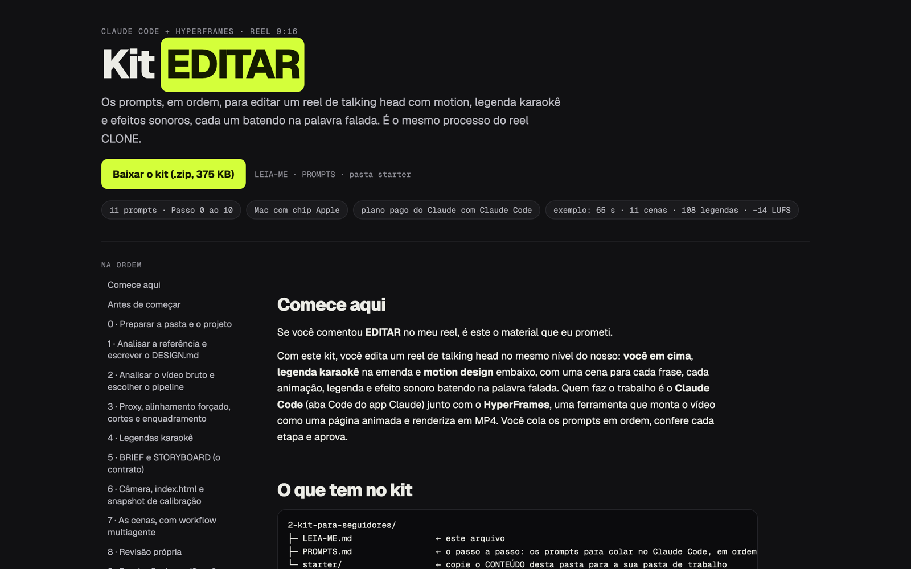

# Kit EDITAR — motion reels edited by AI

**The prompts, in order, to edit a talking-head reel with motion design, karaoke captions and sound effects, each one landing on the spoken word — using Claude Code and HyperFrames.**

**[▶ Open the kit site](https://kit-edit.vercel.app)** · **[⬇ Download the kit (.zip, 375 KB)](https://kit-edit.vercel.app/kit-reel-ia.zip)**



## What it is

I made this kit for everyone who commented **EDITAR** ("edit" in Portuguese) on one of my Instagram reels. It's the same process I use to edit my own reels: **you on top**, **karaoke captions** across the seam and **motion design** below, with an animated scene for every sentence.

The kit content (prompts, guide and site) is in Brazilian Portuguese.

The heavy lifting is done by **[Claude Code](https://claude.ai/download)** together with **[HyperFrames](https://hyperframes.heygen.com)**, a tool that builds the video as an animated web page and renders it to MP4. You paste the prompts in order, check each step and approve it.

## How it works

There are 11 prompts, from step 0 to step 10:

| Step | What happens |
|---|---|
| 0 | Set up the folder and the project |
| 1 | Analyse the reference reel and write `DESIGN.md` (colours, typography, pacing) |
| 2 | Analyse the raw footage and choose the pipeline (several raw takes or a single pre-cut file) |
| 3 | Proxy, word-by-word forced alignment, cuts and face framing |
| 4 | Karaoke captions |
| 5 | Brief and storyboard: the "contract" for each scene |
| 6 | Camera, `index.html` and a calibration snapshot |
| 7 | The scenes, built and reviewed by a multi-agent workflow |
| 8 | Self-review |
| 9 | Final render and checks (9:16 format, audio at −14 LUFS) |
| 10 | Fine-tuning in HyperFrames Studio |

The kit's example is **65 seconds long, with 11 scenes and 108 captions**.

## What's in this repository

```text
site/                        the site deployed on Vercel (single page with a copy button for each prompt)
kit/
├─ LEIA-ME.md                start here
├─ PROMPTS.md                the step-by-step guide, prompt by prompt
└─ starter/
   ├─ PADRAO-DE-QUALIDADE.md rules for format, captions, motion and audio + final checklist
   ├─ RECEITAS-DE-MOTION.md  59 motion recipes with exact values (duration, easing, scale)
   └─ template-reel/
      ├─ DESIGN.md · BRIEF-exemplo.md · STORYBOARD-exemplo.md
      ├─ scenes-exemplo/     8 scenes from example 1, ready to adapt
      ├─ scenes-exemplo-2/   11 scenes from example 2, ready to adapt
      ├─ fonts/              Geist and Geist Mono (OFL licence)
      └─ edit/               scripts for alignment, cuts, captions, framing and the scene workflow
```

## How it was made

The kit was assembled and tested by a **workflow of 7 AI agents** (~49 minutes):

- **3 builders:** one for the starter folder, one for the prompts and one for the reel script.
- **2 adversarial verifiers:** one followed the kit from scratch as a beginner and ran every script; the other checked facts, timings and the tone of the writing.
- **2 fixers**, who applied what the verifiers found.

With their original values, the kit's scripts reproduce the example reels' files exactly.

## Requirements

- Mac with Apple silicon (M1, M2, M3…)
- A paid Claude plan, with Claude Code
- Homebrew, Node, ffmpeg, whisper.cpp, uv and the HyperFrames skills (`LEIA-ME.md` explains everything, even if you've never opened Terminal)

## What's not included (on purpose)

- **Sound effects:** the Pixabay licence allows using them in videos but not redistributing the files. Installing HyperFrames gives you the same sounds.
- **Videos, recordings and screenshots** from my reels.
- **Real creator handles:** in the example scenes they were replaced with `@criador_1` and `@criador_2`.
